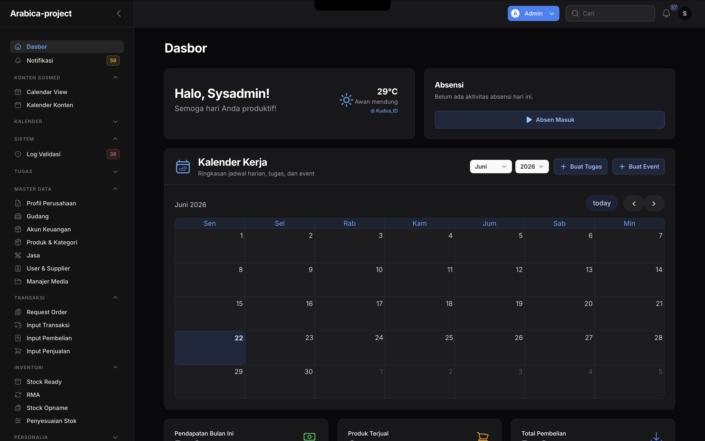
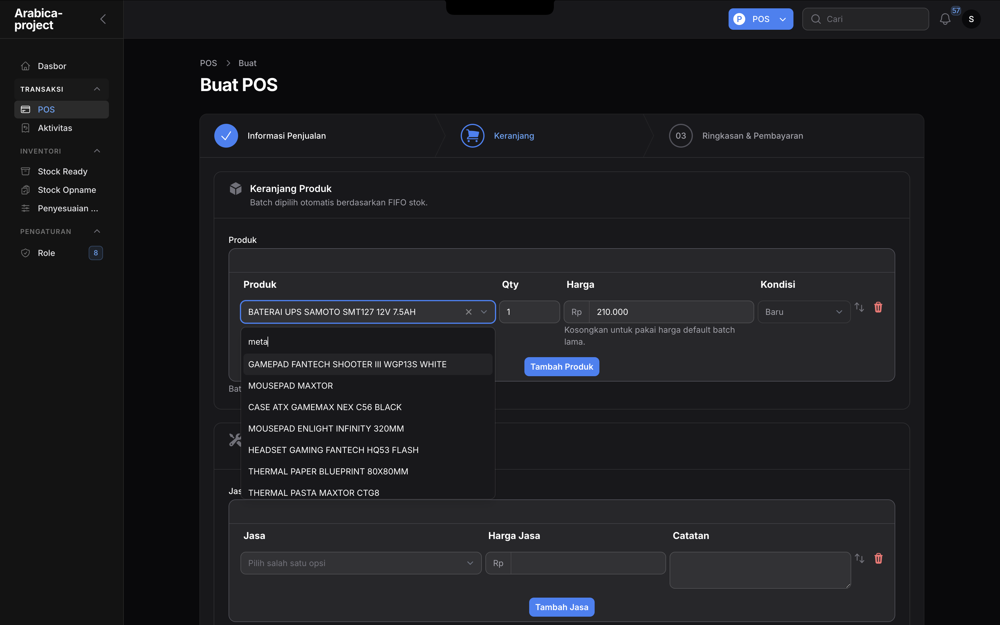
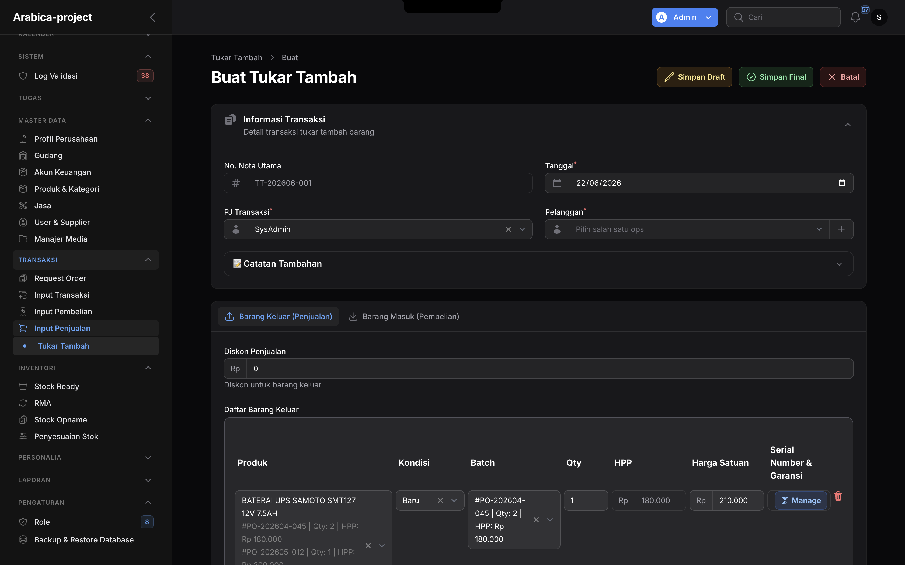
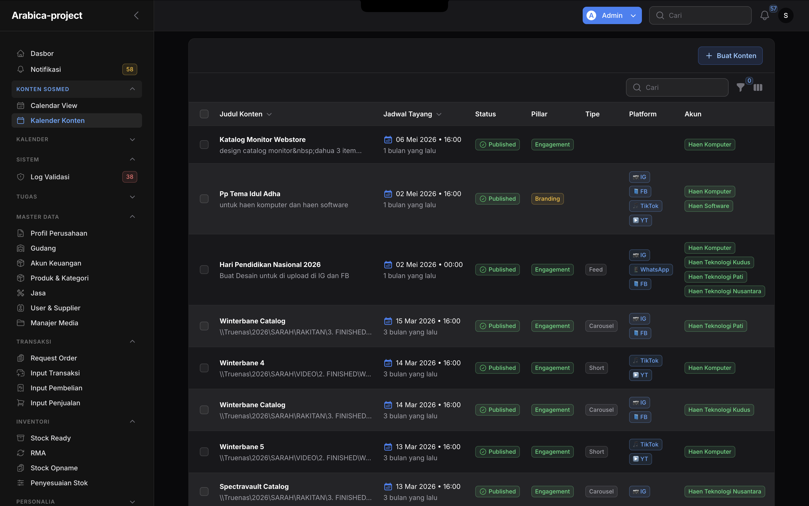

<div align="center">

# ☕ Arabica — Enterprise ERP & POS System

[](https://laravel.com)
[](https://filamentphp.com)
[](https://livewire.laravel.com)
[](https://php.net)
[](https://mysql.com)
[](https://docker.com)
[](https://web.dev/progressive-web-apps/)

> **Portfolio Notice:** This is a public documentation mirror of a **private, production-grade enterprise application**. The full source code is hosted privately under the client's organization. This repository showcases the system's architecture, feature set, and UI/UX design to demonstrate the scope and technical depth of the work.
>
> 📌 **Built by:** [Galih](https://github.com/galih) &nbsp;|&nbsp; **Client:** Haen Komputer &nbsp;|&nbsp; **Status:** ✅ Production

</div>

---

## 🎯 Project Overview

**Arabica** is a fully bespoke **Enterprise Resource Planning (ERP) and Point of Sale (POS)** system commissioned for **Haen Komputer** — a multi-branch retail store specializing in computers, smartphones, and repair services.

The system consolidates every operational touchpoint of the business into a single, unified platform: from cashier transactions and trade-in negotiations, to warehouse management, payroll, financial reporting, and social media scheduling — all within a premium, responsive interface.

| Dimension | Detail |
|---|---|
| **Type** | Full-stack web application (SaaS-style, single tenant) |
| **Deployment** | Self-hosted on VPS via Docker + Nginx reverse proxy |
| **Users** | Cashiers, Warehouse Staff, Technicians, HR, Managers, Admin |
| **Scale** | ~20 concurrent daily users, thousands of product SKUs |
| **Timeline** | Active development & maintenance: Jan 2026 – Present |

---

## 🖼️ Interface Showcase

<details open>
<summary><b>📸 Click to expand screenshots</b></summary>

<br>

<p align="center">
  <b>1. Executive Admin Dashboard (Dark Mode)</b><br><br>
  <br>
  <sub>Real-time KPI widgets, monthly revenue trend chart, sales-by-category breakdown, and low-stock alerts. Features a custom draggable sidebar resizer persisted to localStorage.</sub>
</p>

<br>

<p align="center">
  <b>2. POS Cashier Terminal</b><br><br>
  <br>
  <sub>Split-panel cashier interface: left product catalog with real-time stock badges, right order cart with inline discount logic, payment method selection (Cash / Transfer / QRIS), and one-click checkout.</sub>
</p>

<br>

<p align="center">
  <b>3. Trade-In (Tukar Tambah) Wizard</b><br><br>
  <br>
  <sub>5-step guided wizard for customer device exchange: device grading, condition assessment, valuation calculation, new product selection, and transaction summary — with live pricing offsets.</sub>
</p>

<br>

<p align="center">
  <b>4. Social Media Content Planner</b><br><br>
  <br>
  <sub>Kanban-style marketing board with 4 pipeline stages (Draft → Scheduled → Published → Failed). Integrated with platform filters (Instagram, Facebook, TikTok) and staff assignment.</sub>
</p>

</details>

---

## 🏗️ System Architecture

For a full technical deep-dive, see **[`docs/ARCHITECTURE.md`](docs/ARCHITECTURE.md)**.

### High-Level Architecture

```
┌─────────────────────────────────────────────────────────────────────┐
│                        ARABICA SYSTEM                               │
│                                                                     │
│  ┌─────────────┐    ┌──────────────────┐    ┌──────────────────┐   │
│  │  Filament   │    │   Laravel Core   │    │  Background Jobs │   │
│  │   Admin     │───▶│  (Controllers,   │───▶│  (Queue Worker,  │   │
│  │   Panel     │    │  Livewire, API)  │    │  Schedulers)     │   │
│  └─────────────┘    └────────┬─────────┘    └────────┬─────────┘   │
│                              │                        │             │
│              ┌───────────────┼────────────────────────┘             │
│              ▼               ▼                                      │
│  ┌──────────────────┐  ┌──────────────┐  ┌───────────────────────┐ │
│  │  MySQL 8.x (DB)  │  │  Redis Cache │  │  External APIs        │ │
│  │  - Stock Batches │  │  - Sessions  │  │  - WooCommerce REST   │ │
│  │  - Mutations Log │  │  - Queues    │  │  - OpenWeather API    │ │
│  │  - Audit Trails  │  │  - Cache     │  │  - QRIS Payment GW    │ │
│  └──────────────────┘  └──────────────┘  └───────────────────────┘ │
│                                                                     │
│  ┌───────────────────────────────────────────────────────────────┐  │
│  │  Docker: Nginx + PHP-FPM + MySQL + Redis + Queue Worker       │  │
│  └───────────────────────────────────────────────────────────────┘  │
└─────────────────────────────────────────────────────────────────────┘
```

---

## ⚙️ Core Modules

<details>
<summary><b>🛍️ Point of Sale (POS) & Retail Sales</b></summary>
<br>

| Module | Description |
|---|---|
| **Cashier Terminal** `PosSaleResource` | Optimized quick-checkout UI for store clerks with catalog search, barcode scan compatibility, and cart management |
| **Trade-In Wizard** `TukarTambahResource` | Multi-step transaction flow for customer device exchange — grading, valuation, product selection, and offset pricing calculation |
| **Sales Invoices** `PenjualanResource` | Full billing system with invoice generation, structured discount tiers, and document state lifecycle management |
| **Cashier Shift** `PosActivityResource` | Cash drawer opening/closing, shift-based reconciliation reports, and variance tracking |

</details>

<details>
<summary><b>📦 Inventory & Warehouse Management</b></summary>
<br>

| Module | Description |
|---|---|
| **Multi-Warehouse Tracking** `GudangResource` | Monitor stock allocation across multiple physical locations and storefront areas |
| **Serial Number Tracking** | Per-unit serial number registration and lookup for high-value devices |
| **Stock Opname** `StockOpnameResource` | Scheduled physical inventory count with discrepancy reconciliation tool |
| **Stock Adjustment** `StockAdjustmentResource` | Manual stock corrections with reason codes (damage, display, shrinkage) |
| **Low Stock Alerts** | Configurable reorder-level warnings surfaced on dashboard widgets |

</details>

<details>
<summary><b>🔌 Purchasing & Returns (RMA)</b></summary>
<br>

| Module | Description |
|---|---|
| **Purchase Orders** `PembelianResource` | Procurement management with incoming cost averaging, supplier tracking, and barcode label printing |
| **RMA Workflow** `RmaResource` | End-to-end return handling: customer returns, in-store repairs, warranty claims, and vendor-side RMA logistics |

</details>

<details>
<summary><b>💼 HR, Payroll & Scheduling</b></summary>
<br>

| Module | Description |
|---|---|
| **Geolocated Attendance** `AbsensiResource` | Employee clock-in/out validated via HTML5 Geolocation API against predefined office coordinates |
| **Shift Scheduling** `PenjadwalanTugasResource` | Task calendar for service shifts, deliveries, and store operations |
| **Leave Management** `LiburCutiResource` | PTO requests, approvals workflow, and balance tracking |
| **Payroll Processing** `GajiKaryawanResource` | Monthly salary calculation including overtime, attendance deductions, and sales commissions |

</details>

<details>
<summary><b>📊 Accounting & Financial Reports</b></summary>
<br>

| Module | Description |
|---|---|
| **Cash/Bank Ledger** `InputTransaksiTokoResource` | Non-sales income and expense journal entries |
| **Income Statement** `Laporan Laba Rugi` | Revenue, COGS (HPP), gross & net profit calculation |
| **Balance Sheet** `Laporan Neraca` | Assets, liabilities, and equity summary |

</details>

<details>
<summary><b>📱 Social Media & Marketing</b></summary>
<br>

| Module | Description |
|---|---|
| **Content Planner** `ContentCalendarResource` | Kanban + full-calendar view for coordinating product promotions and social media posts across platforms |

</details>

---

## 🔧 Key Engineering Implementations

### 1. Inventory Mutation with Race Condition Prevention

To prevent overselling and maintain a complete audit trail, inventory uses a `StockBatch` + `StockMutation` architecture instead of naive counter increments.

```
[POS Sale Triggered]
        │
        ▼
  DB Transaction Open
        │
        ▼
  lockForUpdate() on StockBatch   ← Pessimistic lock prevents race conditions
        │
        ▼
  Verify qty_available ≥ qty_requested
        │
        ├── NO  → Rollback + throw InsufficientStockException
        │
        └── YES → Deduct qty_available
                        │
                        ▼
                  Write StockMutation record
                  (type, qty, user_id, reference_document)
                        │
                        ▼
                  DB Transaction Commit
                        │
                        ▼
                  Fire StockChanged Event
                        │
                        ▼
                  Dispatch SyncStockToWooCommerce Job (async)
```

### 2. Document State Lifecycle (Sales & Purchase Orders)

All transactional documents follow a strict, lockable state machine to maintain accounting integrity:

```
  [DRAFT] ──────────────────────────────────► [DRAFT SAVED]
     │         Items locked, payment editable        │
     │                                               │
     │ (delete)                              (post)  │
     ▼                                               ▼
  [DELETED]                                    [FINAL / POSTED]
  (stock reserved                              Stock mutations
   mutations reversed)                         converted to permanent
                                                      │
                                                      │ (1-time void)
                                                      ▼
                                               [DRAFT] ← payment correctable,
                                                         inventory unchanged
                                                      │
                                                      │ (lock)
                                                      ▼
                                               [LOCKED] ← no further edits
```

### 3. WooCommerce Hybrid Stock Sync

```
[Stock Changed Event]
        │
        ├──▶ Observer dispatches SyncStockToWooCommerce job
        │           │
        │           ▼
        │    Queue Worker ──▶ WooCommerce REST API
        │           │              (PUT /products/{id})
        │           └──▶ WooCommerceSyncLog (success/fail + timestamp)
        │
        └──▶ Scheduled Command (every 5 min): sync:woocommerce
                    │
                    ▼
             Fetch all products from WC ──▶ Match by SKU
                    │
                    └──▶ Reconcile discrepancies ──▶ Patch mismatches
```

**Failover strategy:** Exponential backoff retry (max 3 attempts), then logged as `failed` with full error context for manual review.

### 4. Geofence Attendance Validation

```javascript
// Browser-side check before form submission
navigator.geolocation.getCurrentPosition((position) => {
    const distance = haversine(
        position.coords,
        STORE_COORDINATES  // Injected from server config
    );
    if (distance > MAX_RADIUS_METERS) {
        // Block submission, show warning
    } else {
        submitAttendanceForm();
    }
});
```

---

## 🎨 UI/UX Design System

The interface is built on **Filament v3** with extensive customizations:

| Feature | Implementation |
|---|---|
| **Draggable Sidebar** | Custom JS `#sidebar-resizer` handler, width persisted to `localStorage` |
| **Dark / Light Mode** | Full Tailwind dark variant support with custom theme overrides |
| **Glassmorphism Cards** | `backdrop-filter: blur()` + semi-transparent backgrounds on dashboard widgets |
| **Micro-animations** | CSS transitions on hover states, scale transforms on interactive buttons |
| **Weather Widget** | OpenWeather API integration with real-time temperature and condition display |
| **PWA Support** | Installable on mobile/tablet via `silviolleite/laravelpwa` service worker |

---

## 🛠️ Technology Stack

### Backend
| Layer | Technology |
|---|---|
| Language | PHP 8.2+ |
| Framework | Laravel 12.x |
| Admin Panel | Filament v3 (Livewire + Alpine.js) |
| Database | MySQL 8.x / MariaDB |
| Cache & Queues | Redis |
| Background Jobs | Laravel Horizon / Queue Worker |
| PDF Export | barryvdh/laravel-dompdf |
| Role & Permissions | bezhansalleh/filament-shield |

### Frontend
| Layer | Technology |
|---|---|
| Styling | Tailwind CSS 3.x + Custom Theme |
| Reactivity | Livewire 3 / Alpine.js |
| Build Tool | Vite |
| Calendar UI | saade/filament-fullcalendar |
| Kanban UI | mokhosh/filament-kanban |

### Infrastructure
| Layer | Technology |
|---|---|
| Containerization | Docker + Docker Compose |
| Web Server | Nginx (reverse proxy) |
| Process Management | PHP-FPM |
| VCS | Git (private GitHub org) |

### Testing & Quality
| Tool | Purpose |
|---|---|
| Pest PHP | Modern BDD-style test runner |
| PHPUnit | Unit & integration assertions |
| Laravel Pint | Code style enforcement (PSR-12) |
| Laravel Pail | Real-time log tail in development |

---

## 📁 Repository Structure (Key Areas)

```
arabica/
├── app/
│   ├── Filament/Resources/     # All admin panel resource definitions
│   │   ├── PosSaleResource/    # POS cashier terminal
│   │   ├── TukarTambahResource/# Trade-in wizard
│   │   ├── PenjualanResource/  # Sales invoices
│   │   ├── GudangResource/     # Warehouse management
│   │   └── ...                 # 20+ other modules
│   ├── Models/                 # Eloquent models with relations & scopes
│   ├── Observers/              # Model observers for event dispatch
│   ├── Jobs/                   # Background queue jobs (WC sync, reports)
│   └── Services/               # Business logic layer (StockService, etc.)
├── database/
│   ├── migrations/             # 80+ versioned schema migrations
│   └── seeders/                # Role, permission, and sample data seeders
├── docs/                       # Technical documentation per feature
├── screenshots/                # UI showcase images
├── docker/                     # Nginx config, PHP config overrides
├── Dockerfile
└── docker-compose.yml
```

---

## 📄 License & Confidentiality

This application is **proprietary software** developed under contract. All intellectual property rights belong to **Haen Komputer**. The source code is not publicly available. This documentation repository is shared for **portfolio purposes only**, with explicit acknowledgment from the client.

---

<div align="center">

**Designed & Built by [Galih](https://github.com/galih)**

*If you'd like to discuss this project, technical implementations, or similar work — feel free to reach out.*

</div>
