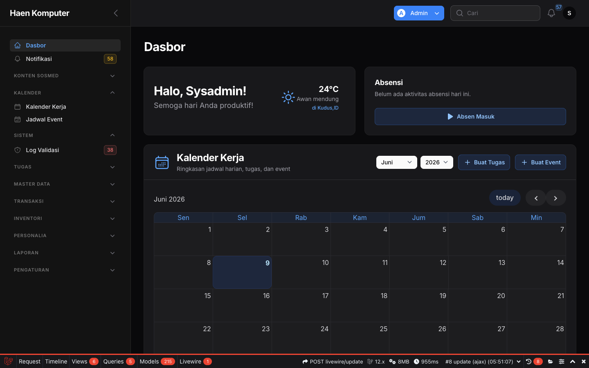
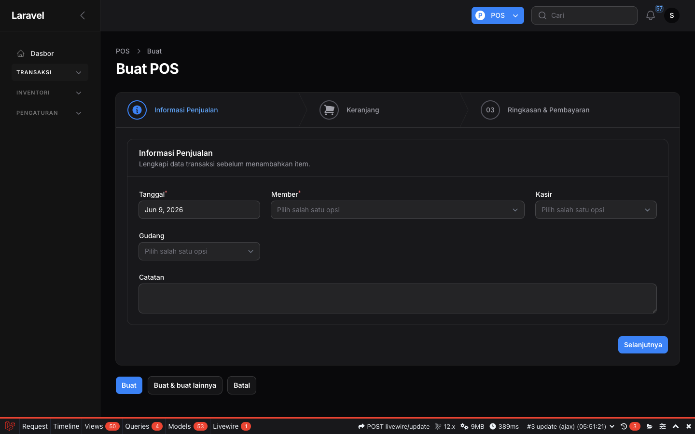
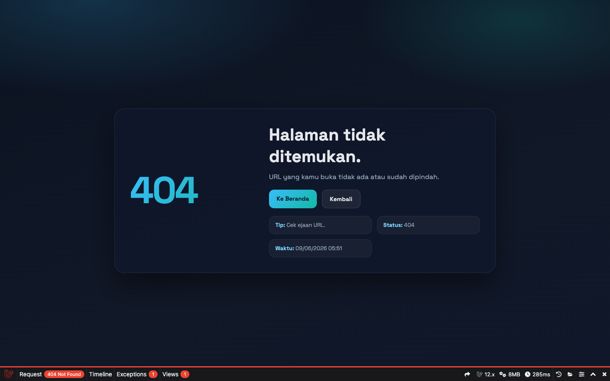
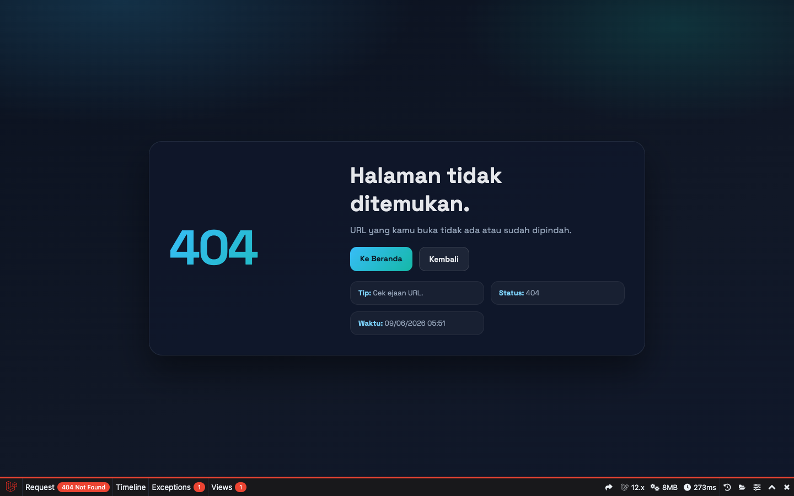

# ☕ Arabica ERP & POS System

[](https://laravel.com)
[](https://filamentphp.com)
[](https://tailwindcss.com)
[](https://livewire.laravel.com)
[](https://mysql.com)
[](https://pestphp.com)
[](https://web.dev/progressive-web-apps/)

> **Disclaimer:** This is a public documentation and mirror repository representing a **private, enterprise-grade application** built for **Haen Komputer** (a retail computer and smartphone sales & services store). The source code is hosted privately. This repository serves to showcase the system's architecture, custom UI/UX implementations, database design, and key features.

---

## 📋 System Overview

**Arabica** is a comprehensive, tailored Enterprise Resource Planning (ERP) and Point of Sale (POS) system designed to handle the complex operations of a computer & smartphone retail outlet. Beyond traditional sales management, it handles complex trade-ins (Tukar Tambah), warranty claims (RMA), multi-warehouse inventory tracking, geofenced employee attendance, shift scheduling, financial ledger reports, and social media scheduling.

The system is designed with a premium, responsive interface featuring interactive dashboards, custom widgets, real-time weather integration, and Progressive Web App (PWA) capability for seamless mobile and tablet operations.

---

## 🏗️ Technical Architecture & Key Implementations

This section outlines several complex engineering challenges resolved in the codebase:

### 1. Stock Batching & Race Condition Prevention
To prevent overselling and maintain audit trails, the application implements a dedicated `StockBatch` management layer instead of simple database increments/decrements.
* **Pessimistic Locking**: Prevents race conditions during simultaneous sales (e.g., when two cashiers sell the last unit of a product). The system locks database records using `lockForUpdate()` during mutations.
* **Audit Trail**: Every inventory action (Sales, Returns, Stock Opname, Stock Adjustment) writes to a `StockMutation` history log to capture the change, the user who triggered it, and the reference document.

```
┌─────────────────────────────────────────────────────────────────────────────┐
│ TRANSACTION MUTATION LIFECYCLE                                              │
│                                                                             │
│  [Cashier POS Sale] ──► DB Transaction Start ──► lockForUpdate() on Batch   │
│                                                            │                │
│                                                            ▼                │
│  [StockMutation Log] ◄── [Update qty_available] ◄── [Verify Availability]   │
│          │                                                                  │
│          ▼                                                                  │
│  DB Transaction Commit ──► Event Triggered ──► Sync WooCommerce Queue       │
└─────────────────────────────────────────────────────────────────────────────┘
```

### 2. Document State Lifecycle
Sales and Purchase orders follow a strict, lockable lifecycle state machine to maintain accounting integrity:
* **Draft**: Fully editable. Deducts stock temporarily and creates `sale_draft` stock mutations.
* **Draft (Saved)**: Locks the items and service line details. Only payment details remain editable. Can be deleted to release reserved stock.
* **Final (Posted)**: Read-only document. Converts stock mutations from draft to permanent status. Supports a **1-time Void back to Draft** to correct payment mistakes without restoring inventory.
* **Final (Locked)**: Permanently locked. Absolutely no edits allowed.

### 3. WooCommerce Hybrid Stock Sync
Maintains inventory synchronization between physical store inventory and a WooCommerce-based e-commerce platform:
* **Event-Driven Sync**: Laravel Observers detect stock level changes and instantly dispatch a `SyncStockToWooCommerce` job to a background queue.
* **Periodic Reconciliation**: A Laravel schedule runner executes a reconciliation command every 5 minutes (`sync:woocommerce`) to fetch latest stock, match by SKU, and resolve any API mismatch discrepancies.
* **Failover Protection**: Jobs include timeout retry, exponential backoff, and a logged sync history table (`WooCommerceSyncLog`).

### 4. Geofence Attendance Validation
Employee Clock-in (`Absensi`) is validated using custom JavaScript hooks interacting with the HTML5 Geolocation API, checking browser coordinates against the office/store coordinates prior to submitting the entry.

---

## 🎨 UI/UX & Design Highlights

The system prioritizes a premium, high-fidelity aesthetic customized using Laravel Filament v3 panel configurations:

* **Draggable Sidebar Resizer**: A custom-built, draggable resize handler (`#sidebar-resizer`) allows store managers to scale the admin panel sidebar to their preferences, storing the layout state in local storage.
* **Interactive Dashboards**: Loaded with custom widgets including low-stock alerts, monthly revenue charts, recent transactions lists, personal tasks, and weather updates (OpenWeather API integration).
* **Glassmorphism & Micro-animations**: Calendar entries and interactive buttons feature smooth transitions, hover effects, scale transformations, and customized styles matching alert colors.
* **Fully Responsive Light & Dark Mode**: Handcrafted Tailwind overrides support seamless transitions between light and dark environments.

### 📸 Showcase Screenshots

Here is a visual walk-through of Arabica's custom-themed modules:

<p align="center">
  <b>1. Executive Admin Dashboard (Dark Mode)</b><br>
  <br>
  <i>Features customizable draggable sidebar, real-time widgets, and analytics charts.</i>
</p>

<br>

<p align="center">
  <b>2. Cashier POS Terminal</b><br>
  <br>
  <i>Fast catalog navigation, barcode scanning compatibility, and cart checkout.</i>
</p>

<br>

<p align="center">
  <b>3. Trade-In (Tukar Tambah) Wizard</b><br>
  <br>
  <i>Multi-step workflow for customer device grading, valuation, and offset pricing.</i>
</p>

<br>

<p align="center">
  <b>4. Social Media Content Planner</b><br>
  <br>
  <i>Kanban schedule tracker categorized by draft, scheduled, published, and failed states.</i>
</p>

---

## ⚙️ Core Modules & Features

<details>
<summary><b>🛍️ Point of Sale (POS) & Retail Sales</b></summary>

* **Cashier Terminal (`PosSaleResource`)**: Optimized quick-sell checkout page for store clerks.
* **Trade-in Module (`TukarTambahResource`)**: Complex transaction wizard allowing customers to exchange their old devices for new products, calculating trade-in valuations and factoring them into final checkout balances.
* **Sales Invoices (`PenjualanResource`)**: Full-featured billing system with invoice generation, barcode support, and structured discount structures.
* **Cashier Activity Tracking (`PosActivityResource`)**: Records active cash register shifts, opening balance checks, and daily cash drawer reconciliation reports.
</details>

<details>
<summary><b>📦 Inventory & Warehouse Management</b></summary>

* **Multi-Warehouse Stock Tracking (`GudangResource`)**: Monitor product allocation across multiple warehouses and storefront areas.
* **Serial Number Tracking**: Assign, register, and check serial numbers (`serials`) for high-value computers, parts, and smartphones.
* **Stock Opname (`StockOpnameResource`)**: Scheduled physical inventory counts and stock reconciliation tool.
* **Stock Adjustment (`StockAdjustmentResource`)**: Log manual stock adjustments with reason codes (e.g., damaged items, display units).
* **Low Stock Warnings**: Visual alerts and priority lists showing products nearing reorder levels.
</details>

<details>
<summary><b>🔌 Purchasing & Returns (RMA)</b></summary>

* **Purchase Orders (`PembelianResource`)**: Manage stock procurement from suppliers, calculating incoming cost averages and printing barcode labels.
* **Return Merchandise Authorization (`RmaResource`)**: End-to-end management of customer returns, repairs, store warranty claims, and vendor-returned RMA logistics.
</details>

<details>
<summary><b>💼 HR Operations & Scheduling</b></summary>

* **Geolocated Attendance (`AbsensiResource`)**: Employee check-in/out requiring browser location coordinates verifying their physical presence.
* **Shift Scheduling (`PenjadwalanTugasResource`)**: Task allocation calendar managing technical service shifts, deliveries, and standard store operations.
* **Leaves Management (`LiburCutiResource`)**: Paid time off requests, approvals, and balance trackers.
* **Payroll Processing (`GajiKaryawanResource`)**: Monthly base salary, overtime calculations, attendance penalties, and sales commission distributions.
</details>

<details>
<summary><b>📊 Accounting & Financial Reports</b></summary>

* **Cash / Bank Ledger (`InputTransaksiTokoResource`)**: Records daily non-sales expense items (utility bills, store supplies) and non-purchase income.
* **Financial Statements**:
  * **Income Statement (`Laporan Laba Rugi`)**: Calculates operating revenues, COGS (HPP), and net profits.
  * **Balance Sheet (`Laporan Neraca`)**: Summarizes store assets, liabilities, and equity balances.
</details>

<details>
<summary><b>📱 Social Media & Marketing</b></summary>

* **Content Planner (`ContentCalendarResource`)**: Marketing campaign board using Kanban views and full calendar layouts to coordinate product promotions and social media releases.
</details>

---

## 🛠️ Technology Stack & Dependencies

### Core Stack
* **PHP**: 8.2+
* **Framework**: Laravel 12.x
* **Database**: MySQL 8.x / MariaDB
* **Admin Portal**: Filament v3 (Livewire & Alpine.js base)
* **Styling**: Tailwind CSS, PostCSS, Custom Theme (`nuxtifyts/dash-stack-theme`)
* **Build Tool**: Vite

### Third-Party PHP Packages
* `spatie/eloquent-sortable` - Draggable sorting for resource orders.
* `bezhansalleh/filament-shield` - Role and permission management.
* `saade/filament-fullcalendar` - Rich scheduling overlays.
* `mokhosh/filament-kanban` - Kanban board implementation for tasks and marketing.
* `barryvdh/laravel-dompdf` - Dynamic invoice and report PDF exporting.
* `laravolt/indonesia` - Database-driven regional search (Provinces, Cities, Districts).
* `silviolleite/laravelpwa` - Progressive Web App service worker integration.
* `akaunting/money` - Accurate currency display and conversion.

### Testing & Quality Assurance
* **Pest PHP**: Modern testing runner.
* **PHPUnit**: Backend unit & integration assertions.
* **Laravel Pail**: Real-time console log monitoring.
* **Laravel Pint**: Code linting and style fixer.

---

## 🚀 Running / Testing Locally

For testing purposes, the repository can be set up in a local development environment.

### Prerequisites
* PHP 8.2+
* Composer
* Node.js & NPM
* MySQL / SQLite

### Installation Steps
1. Clone the public mirror:
   ```bash
   git clone https://github.com/your-username/arabica-shadow.git
   cd arabica-shadow
   ```
   *(Note: Since this is a public mirror designed to showcase the README only, code files are not present here. To look at the implementation structure, please review the files outline above.)*

2. In the private source repo, local setup is executed via Composer:
   ```bash
   composer run setup
   ```
   This script triggers:
   * Dependency installation (`composer install` & `npm install`)
   * Key generation (`php artisan key:generate`)
   * Database migration (`php artisan migrate --force`)
   * Asset build (`npm run build`)

3. Run the hot-reloading development server:
   ```bash
   composer run dev
   ```
   This command starts the local server, Vite assets watcher, queue worker, and Pail logs tailer simultaneously.

4. Run tests:
   ```bash
   composer run test
   ```

---

## 📄 License
This application is proprietary software and is not open for public licensing. All rights reserved by **Haen Komputer**.
